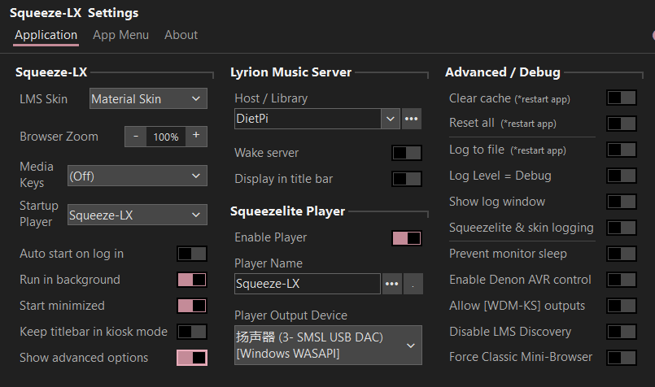
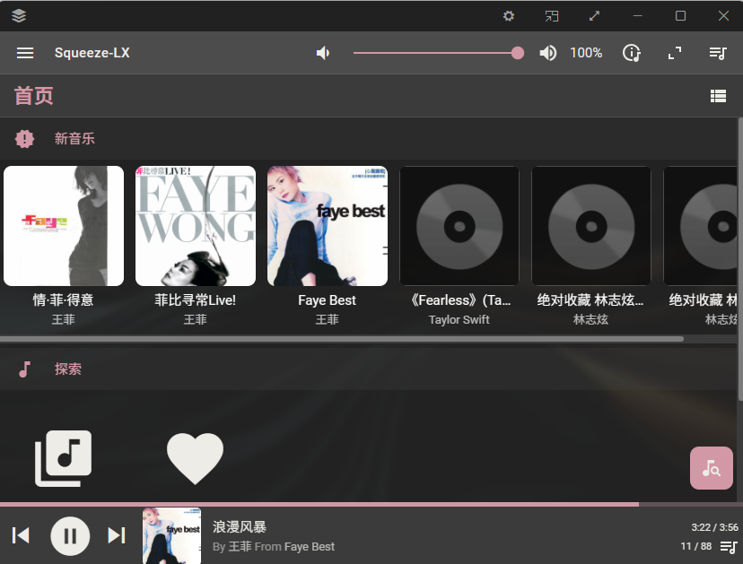

# Windows 11 安装 Squeezelite 客户端指南（Squeeze-LX）

在局域网内搭建好 **Lyrion Music Server (LMS)**（例如运行在 DietPi / 树莓派上）之后，用 Windows 11 上的轻量瘦客户端 **Squeeze-LX**（原 Squeezelite-X）作为播放端，并通过 **WASAPI** 把音频直通给 USB DAC。

## 背景与痛点

Windows 11 本地 Microsoft Store 往往搜不到官方推荐的图形化客户端 Squeeze-LX。本文记录实测可行的完整流程：通过切换系统区域从商店安装；若商店方案彻底不可用，则改用官方命令行版免依赖离线部署。

> 原文档标题中的「离线」对应文末的备选方案；主流程为切换区域后在线安装。原始文本存档见 [`docs/Squeeze-LX.txt`](docs/Squeeze-LX.txt)。

---

## 安装步骤

### 1. 获取客户端（绕过本地商店）

| 方案 | 操作 | 适用情况 |
| --- | --- | --- |
| 主方案：Microsoft Store | 切美区 → 重启 → 搜索 `Squeeze-LX` → 安装 | 商店可访问，希望图形界面 |
| 备选方案：命令行版 | 从 SourceForge 的 `lmsclients` 项目下载 `squeezelite-win64.zip`，解压后用命令行或批处理运行 | 商店彻底失效 / 需要完全离线 |

主方案详细步骤：

1. 打开 Windows 11 **设置 > 时间和语言 > 语言和区域**。
2. 将「国家或地区」切换为 **美国 (United States)**。
3. 重启电脑。
4. 打开 **Microsoft Store**，搜索 **`Squeeze-LX`**（注意：商店里不叫 Squeezelite-X，必须搜 `Squeeze-LX` 才能找到）。
5. 点击安装并等待完成。
6. *（可选）* 安装完成后可把系统区域改回原样，不影响应用运行。

### 2. 自动发现服务器

打开 Squeeze-LX 后，只要电脑与 LMS 服务器在同一个局域网内，软件会通过 **UDP 广播**自动发现服务器。设置界面的 `Lyrion Music Server` 区域中，`Host / Library` 会自动填入服务器名称（本例中为 `DietPi`）。

### 3. 音频输出设置（核心：选择 WASAPI）

`Player Output Device` 下拉菜单中，同一个 DAC 通常会出现 `[MME]` 和 `[Windows WASAPI]` 两种接口：

| 接口 | 说明 | 建议 |
| --- | --- | --- |
| `[MME]` | Windows 最老的基础驱动接口，兼容性好，但会经过系统混音器 | ❌ 不选 |
| `[Windows WASAPI]` | 绕过系统混音器，把音频数据更直接地送给 DAC，避免系统对声音做多余加工 | ✅ 选择（如 `扬声器 (3- SMSL USB DAC) [Windows WASAPI]`） |

### 4. 推荐配置（省心后台化）

在 `Application` 选项卡中建议开启以下三项：

| 选项 | 作用 |
| --- | --- |
| ✅ `Auto start on log in` | 开机自启，省去每次手动打开 |
| ✅ `Run in background` | 点关闭按钮时缩到系统托盘继续播放，不中断音乐 |
| ✅ `Start minimized` | 开机启动时不弹窗，直接静默在托盘待命 |

若在 `Advanced / Debug` 中发现屏幕总是自动熄灭影响听歌，可打开 `Prevent monitor sleep` 防止系统休眠。设置完成后点击 **Apply** 保存。

**设置界面参考**：`Host / Library` 自动发现为 `DietPi`，`Player Output Device` 已选 `[Windows WASAPI]`，左侧三项后台化开关均已开启。

---

## 最终效果

1. **DietPi (LMS)** 统一管理曲库、专辑封面和播放列表。
2. **Squeeze-LX** 作为极轻量的瘦客户端，在后台静默运行。
3. 通过 **WASAPI** 将无损音频 bit-perfect 直通给 **SMSL USB DAC**。
4. 日常选歌控制在手机或平板浏览器打开 LMS 的 Web 界面即可。

**客户端主界面**：曲库封面、专辑列表与底部播放条。

相比 Foobar2000 这类本地播放器，这种「服务器-客户端」架构在多房间同步、统一曲库管理上省心得多，适合家庭音乐服务器场景。

---

## 踩坑记录

| 现象 | 原因 | 处理 |
| --- | --- | --- |
| 商店搜不到应用 | 国内区域或部分网络环境下不上架 | 切换美区并搜索 `Squeeze-LX` |
| DAC 后面跟着 `[MME]` | 走的是老驱动接口，非音质首选 | 切换到 `[Windows WASAPI]` 获得纯净直通 |
